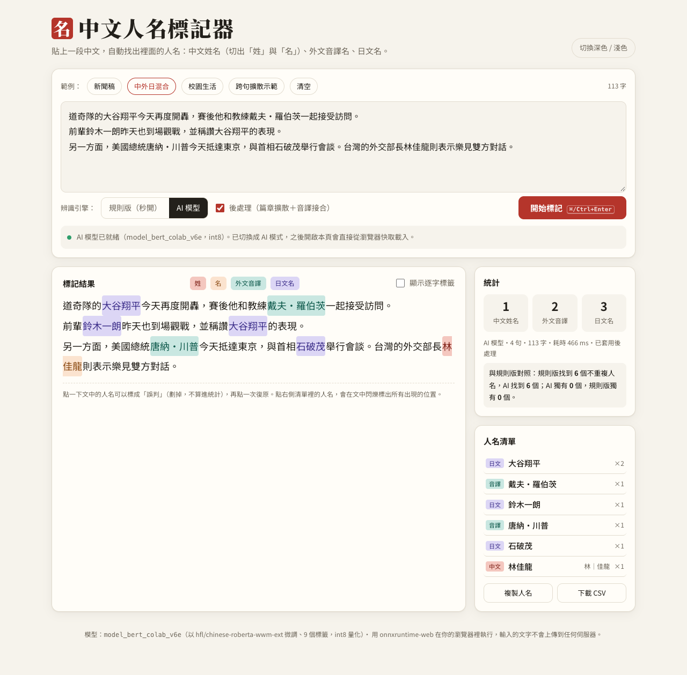

# 中文人名標記器（Web 版）

貼上一段中文，自動找出裡面的人名：中文姓名（切出「姓」與「名」）、外文音譯名、日文名。
BERT 模型（`model_bert_colab_v6e`，int8 量化）用 onnxruntime-web **直接在瀏覽器裡執行**，輸入的文字不會上傳到任何地方。

- 線上試用：GitHub Pages 網址（部署後填入）
- 規格書：[SPEC.md](SPEC.md)



## 檔案

| 路徑 | 說明 |
|---|---|
| `index.html` | 整個網頁（HTML + CSS + JS，內嵌 tokenizer 詞表與姓氏字典） |
| `model/v6e_int8.onnx.part0~2` | int8 量化後的 ONNX 模型，切成三份以符合 GitHub 單一檔案 100 MB 的上限 |
| `tools/export_onnx.py` | PyTorch → ONNX → int8 量化 |
| `tools/verify_onnx.py` | 比較量化前後的 F1 |
| `tools/inline_data.py` | 把詞表／姓氏字典寫進 index.html |

## 本機執行

```bash
python3 -m http.server 8000   # 然後打開 http://localhost:8000
```
（直接雙擊開啟 `file://` 無法下載模型，要透過 http 開啟。）
